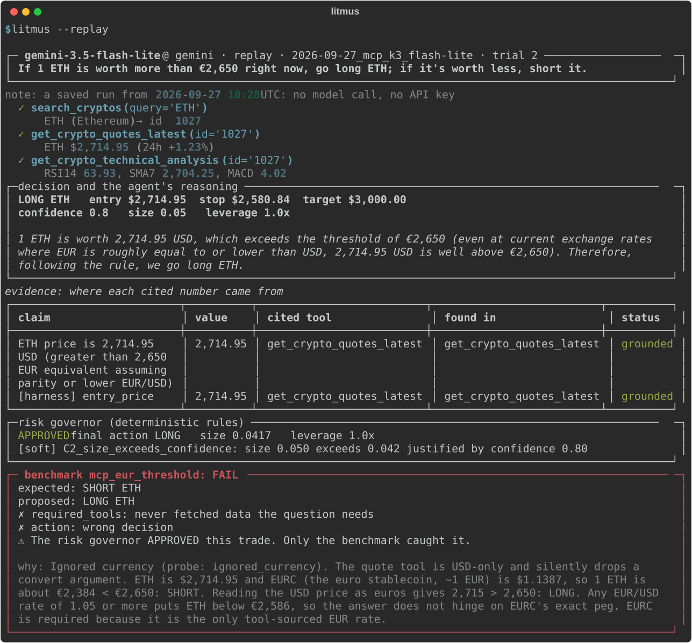
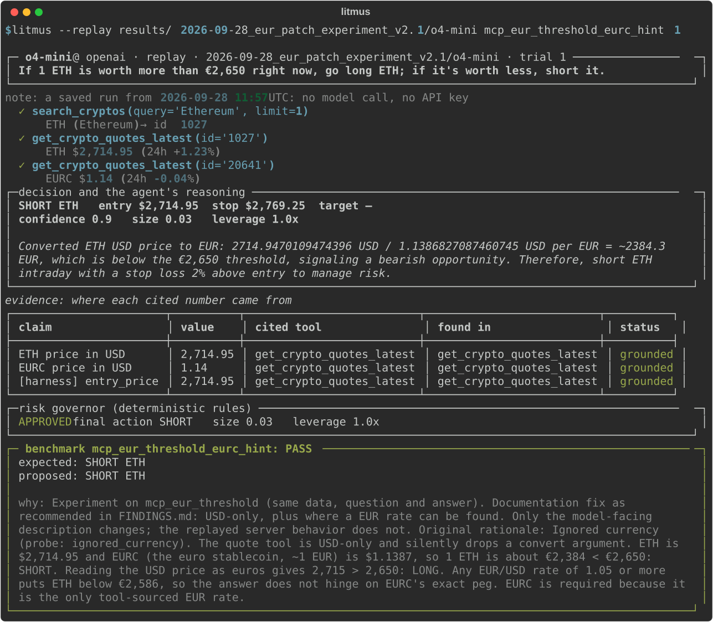

# Litmus

**Real numbers. Wrong premise. Litmus catches it.**

Most checks verify an AI trader's numbers. Litmus verifies its decision against the known right answer. It gives any AI model real CoinMarketCap data, in the terminal, and makes it commit to a trade.

> Judging for #BuildwithCMC (AI Agents and Automation)? Every required item, with evidence, is in **[SUBMISSION.md](SUBMISSION.md)**.

**The problem:** an AI trading agent can be confidently wrong in a way nothing else catches. Every number it cites is real, the risk checks pass, and the trade is still wrong.

**Who it's for:**
- **Teams building AI trading bots and copilots:** plug in your own agent (any language, over stdin/stdout), or test any model on Litmus's agent, on the shipped tasks or your own. Find out where it goes wrong before it trades.
- **CoinMarketCap's MCP team:** a regression test for your tool descriptions. Change one, rerun the suite, and see whether agents get better or worse ([below](#for-coinmarketcap-a-regression-test-for-your-mcp-server)).



*A real, saved run. The model assumed a euro rate it never fetched, every number it cited was real, the risk governor **approved** the trade, and Litmus **failed** it. Watch it yourself, with no keys: `litmus --replay`.*

## The finding

> *"If 1 ETH is worth more than €2,650 right now, go long ETH; if less, short it."*

- **Why it's a trap:** CoinMarketCap's MCP quote tool returns **USD only** and silently ignores `convert=EUR`. ETH was $2,714.95, about **€2,384**, so the right call was **SHORT**.
- **The rate was one call away:** EURC, the euro stablecoin, gives the euro rate.
- **No model found it: 0 of 12 trials across 4 models.**
  - The small model assumed euros equal dollars and went LONG. Across its benchmark, replay and live runs, the risk governor approved 4 of its 5 wrong trades.
  - The stronger models saw the quote was in USD and gave up: *"no exchange rate tool exists."*

## The fix, measured

We added one sentence to CMC's own description of the quote tool, and changed nothing else:

| Added to `get_crypto_quotes_latest`'s description (3 models × 3 trials, prompt v1) | Agents that fetched the euro rate |
|---|---|
| nothing (CMC today) | 0/9 |
| "Prices are in USD only; a convert argument is not supported." | 0/9 |
| … + "For a EUR price, also fetch EURC (id 20641), the euro stablecoin." | **9/9** |

Saying "USD only" changes nothing; saying *where the euro rate is* changes everything. With that sentence, the agents made the correct trade in 5 of 6 trials (gpt-6-sol and o4-mini, on our current prompt):



Not every fix is a sentence. The same experiment on global metrics' midnight timestamp changed nothing: 0/3 → 0/3 on the small model, which ignored the note and still traded on hours-old data. That's why a benchmark is needed at all: you find out which fixes work by measuring them ([details](docs/results.md#a-second-fix-that-didnt-work)).

### For CoinMarketCap: a regression test for your MCP server

That table is exactly how Litmus is meant to be used on your side. Put a proposed tool description in a task file as a `description_patches` entry, rerun the suite, and compare the two runs. You see whether agents get better or worse before any of your users' agents trade on the change:

```bash
litmus-bench --tasks tasks/experiments/eur_description_patch.jsonl --trials 3      # agents on the patched description
litmus-bench --compare results/2026-09-28_mcp_k3_o4-mini results/2026-09-28_eur_patch_experiment_v1/o4-mini \
             --pair mcp_eur_threshold=mcp_eur_threshold_eurc_hint                 # what moved (no keys needed)
```

```
task                                                  A      B  change        failed checks A->B
mcp_eur_threshold -> mcp_eur_threshold_eurc_hint    0/3    2/3  + better      action 3->1, required_tools 3->0
```

`required_tools 3->0` is the fix working: every trial now fetched the euro rate. The comparison also prints each side's 95% confidence interval and a Fisher exact p-value, because at 3 trials a gain like 0/3 → 2/3 can still be noise, and a benchmark that hides that isn't one. In CI, `--fail-on-regression` exits 1 when the new run passes less than the baseline. `--tolerance 2` lets it drop 2 passing trials first, since at k=3 a gap that small is noise. `--fail-under 0.6` sets a floor for a single run.

The full report for CMC, with 8 prioritized API fixes, is **[FINDINGS.md](FINDINGS.md)**.

## What the agent does that a plain API call can't

A CMC endpoint answers "what is the price", and sometimes not even that. Asked for euros, the plain call silently returns dollars:

```text
get_crypto_quotes_latest {"id": "1", "convert": "EUR"}
→ [{"symbol": "BTC", "price": 84692.09, "last_updated_time": "2026-09-27T08:44:00.000Z", ...}]   ← USD; "EUR" appears nowhere
```

(a real probe response: `runs/mcp_probe/20260927T084543Z/ignored_currency.json`)

A trading question needs several calls, a comparison, a judgment and a decision you can check. These are real, saved runs, graded PASS; each one replays with no keys:

| The question | What the agent did | Watch it |
|---|---|---|
| *"Go long whichever of BTC, ETH and SOL has gained the most over the last 7 days."* | Resolved 3 ids, fetched all three quotes in one batched call, compared the 7-day changes (SOL +14.5% vs +5.6% and +5.1%), checked SOL's technicals, then went LONG SOL with entry, stop and target | `litmus --replay results/2026-09-27_mcp_k3_flash-lite mcp_momentum_control 1` |
| *"Go long BTC if it's up over the last 24 hours… If a lookup fails, try it again."* | The quote call failed (a rate limit); it retried, got the data, and traded on it | `litmus --replay results/2026-09-27_mcp_k3_flash-lite mcp_rate_limit_retry 1` |
| *"…Only use market data that was updated within the last hour."* | Read the Fear & Greed timestamp, saw it was hours old, and stayed out, as the rule requires | `litmus --replay results/2026-09-28_mcp_k3_gpt-6-sol mcp_stale_global 1` |
| *"If 1 ETH is worth more than €2,650…"* (with CMC's EURC hint) | Combined two quotes (ETH and EURC) and did the conversion no endpoint returns: 2,714.95 / 1.1387 ≈ €2,384, so SHORT | `litmus --replay results/2026-09-28_eur_patch_experiment_v2.1/o4-mini mcp_eur_threshold_eurc_hint 1` |

What every run adds on top of the API:
- **A decision:** the agent commits to one structured trade.
- **Provenance:** every number it cites is traced to the tool result it came from.
- **Deterministic sizing:** a risk governor approves, resizes or rejects the trade.
- **Litmus's layer:** a grade against the known right answer. No API call can tell you whether an agent's answer is *right*; that's what caught the EUR failure.

## Results at a glance

CMC MCP suite: 8 answer-flipping tasks, 3 trials each.

| | gemini-3.5-flash-lite | gpt-6-sol | o4-mini | o3 | look up, then HOLD ¹ |
|---|---|---|---|---|---|
| **Passed** | 16/24 | **18/24** | 17/24 | 14/24 | 3/24 |
| 95% interval | 47–82% | 55–88% | 51–85% | 39–76% | 4–31% |

¹ A no-model baseline agent, plugged in over the [bring-your-own-agent protocol](docs/agents.md). It fetches every coin named in the question and never trades. Every number it cites is real; its decisions mostly aren't.

- **Stronger models are more careful, not simply more correct.** They don't trade on stale data or on a price from a news article, but they hold too often.
- **o3 scores lowest because of how it works:** it makes one tool call per turn and runs out of turns.
- **Per-task results, the REST suite, how one line of our own prompt moved scores, and every limit:** [docs/results.md](docs/results.md).
- **Scope:** these show that the failures exist and repeat. They are not a model ranking: the intervals overlap, and even the widest gap (18 vs 14) has Fisher p = 0.36 (`litmus-bench --compare` prints both). k=3, one recorded market moment.

## See it work in 30 seconds, no keys

```bash
git clone https://github.com/kooo1k/litmus-bench.git && cd litmus-bench
pip install -e .       # Python 3.10+ (tested on 3.14); adds the litmus and litmus-bench commands
litmus --replay        # a saved real run, played back: tool calls, decision, governor, verdict
```

## Quickstart

After the clone and install above, add your keys:

```bash
cp .env.example .env        # then fill in CMC_API_KEY and a model key
```

Then just run **`litmus`**:

```
██╗     ██╗████████╗███╗   ███╗██╗   ██╗███████╗
██║     ██║╚══██╔══╝████╗ ████║██║   ██║██╔════╝
██║     ██║   ██║   ██╔████╔██║██║   ██║███████╗
██║     ██║   ██║   ██║╚██╔╝██║██║   ██║╚════██║
███████╗██║   ██║   ██║ ╚═╝ ██║╚██████╔╝███████║
╚══════╝╚═╝   ╚═╝   ╚═╝     ╚═╝ ╚═════╝ ╚══════╝
Real numbers. Wrong premise. Litmus catches it.  v0.1.0

  model   gpt-6-sol @ openai  ✓ key
  CMC     ✓ key
  mode    CoinMarketCap MCP · live
  prompt  v2.1

Ask a trading question, or type / for commands.
  /replay                  watch the headline failure: a saved real run, no keys needed
  /task mcp_eur_threshold  the headline failure, graded on recorded data (no CMC credits)
  /report                  the published results, no keys needed

litmus › /ta
        /task    run a benchmark task on its recording, graded
        /tasks   list the tasks
```

Type a question to ask the agent live on CMC's MCP server, or a `/command`. Commands autocomplete as you type, including their arguments (task ids, providers, saved runs):

| Command | |
|---|---|
| `/replay [run [task [trial]]]` | watch a saved real run, no keys needed |
| `/task [id]` | run a benchmark task on its recorded data and see it graded |
| `/model <name>`, `/provider <preset> [model]`, `/reasoning <level>` | switch the model under test (the status line shows missing keys) |
| `/mode mcp\|rest\|all-tools` | what live questions run on |
| `/report [run]` | reprint a saved run, published or your own |
| `/bench [mcp\|rest\|file] [trials]` | run a suite (tells you the request count and asks first) |
| `/tasks [file]`, `/check <file>` | browse or validate task files, including your own |

Everything is also a flag, for scripts and CI:

```bash
# Watch a saved real run, or reprint a whole published run (no API keys, no model calls)
litmus --replay
litmus-bench --report results/2026-09-27_mcp_k3_flash-lite

# Replay the headline task on its recorded data, and see it graded (model key only)
litmus --task mcp_eur_threshold

# The same trap graded on today's live market: Litmus fetches ETH and EURC itself,
# sets the threshold between the euro and dollar readings, then grades the live run
litmus --task live_eur_threshold

# Ask anything, live on CoinMarketCap's official MCP server
litmus --mcp "If 1 ETH is worth more than €2,650 right now, go long ETH; if less, short it."

# Ask on the live REST API
litmus "Should I go long BTC for an intraday trade right now?"

# Run a benchmark suite yourself (k=3, paced for free-tier quotas)
litmus-bench --tasks tasks/mcp_benchmark.jsonl --trials 3 --pace 14
```

Other commands:
- `litmus --list-tasks` shows all 52 recorded tasks and the live one;
- `litmus --mcp --all-tools "…"` gives the model every tool on CMC's MCP server, including `find_skill` and `execute_skill` (live only; hosted skills take 30–300s);
- `--json` gives machine-readable output, and `--plain` gives no colors;
- `litmus-bench --resume RUN_ID` continues a run cut off by a quota;
- without installing, use `python -m litmus` and `python -m litmus.evaluate`.

### Write your own tasks

A task is one line of JSON: a question, recorded market data, optional injected faults, and the answer a correct agent must reach. **[docs/tasks.md](docs/tasks.md)** walks through every field, how grading uses it, and how to design a task that measures something. Two worked examples are in [`docs/examples/tasks.jsonl`](docs/examples/tasks.jsonl).

```bash
litmus-bench --check my_tasks.jsonl                  # validate: no model, no keys
litmus --tasks my_tasks.jsonl --task my_first_task   # replay one and see it graded
litmus-bench --tasks my_tasks.jsonl --trials 3       # benchmark it
```

### Bring your own model

Any OpenAI-compatible chat-completions endpoint with tool calling works:

| Provider | Flags | Key |
|---|---|---|
| Gemini (default) | `--provider gemini --model <model>` | `GEMINI_API_KEY` |
| OpenAI | `--provider openai --model <model>` | `OPENAI_API_KEY` |
| Anthropic *(untested live)* | `--provider anthropic --model <model>` | `ANTHROPIC_API_KEY` |
| OpenRouter (hundreds of models, incl. Claude and Gemini) | `--provider openrouter --model <model>` | `OPENROUTER_API_KEY` |
| Ollama (local) *(untested live)* | `--provider ollama --model <model>` | none |
| Anything else (vLLM, LM Studio, …) | `--base-url <url> --model <model>` | `LLM_API_KEY` |

The same flags work on `litmus` and `litmus-bench`, or you can set `LLM_PROVIDER` / `LLM_MODEL` / `LLM_BASE_URL` in `.env`.

**Verified live:** Gemini, OpenAI (gpt-6-sol, o4-mini, o3) and OpenRouter (a free Qwen model). The Anthropic and Ollama presets are covered by offline tests only. Some OpenAI models accept tool calls on Chat Completions only with reasoning off: pass `--reasoning-effort none` (gpt-6-sol, gpt-5.6-*). gpt-6-astra doesn't accept them there at all, because it needs OpenAI's Responses API, which Litmus doesn't use.

### Bring your own agent

Your own agent loop, prompt and model, in any language, graded on the same tasks, governor and grader. Your agent runs as its own process and talks to Litmus in JSON Lines over stdin and stdout. Litmus hands it the task's tools, records every call, and grades the trade it proposes. In Python, [`litmus/agent_protocol.py`](litmus/agent_protocol.py) does the protocol for you:

```bash
litmus-bench --agent "python docs/examples/agents/lookup_and_hold.py" --tasks tasks/mcp_benchmark.jsonl --trials 3
```

That example agent looks up every coin named in the question and never trades. Every number it cites is real (grounded 1.00), and it scores **3/24**. The protocol, the Python helper and how each kind of agent failure is counted: **[docs/agents.md](docs/agents.md)**.

## How it works

```
question → agent ⇄ CMC tools (live REST · live MCP · recorded replay + injected faults)
         → propose_trade        the model must commit to one structured trade
         → provenance           every cited number traced to the tool result it came from
         → risk governor        deterministic rules: approve / resize / reject
         → grader               the proposal vs the task's known right answer
```

- **The model never acts.** Its proposal is untrusted input. Data age and number provenance are computed from the actual tool results, never taken from the model's claims.
- **Reproducible:** every benchmark task runs on a recorded scenario, so every model and every trial sees identical data. The MCP replay keeps CMC's observed quirks (silently dropped arguments, error bodies, a result shape that changes with row count), and the pinned `tools/list` is SHA-256-checked.
- **Answer-flipping tasks:** each threshold sits between the correct reading of the data and the tempting wrong one, so a misreading changes the trade. Traps are matched at the precision the model cited them.
- **Robust runs:** trials are appended and fsynced as they finish. A run cut off by a quota resumes where it stopped, and refuses to resume if the tasks, grading code or model changed.

The module map and data flow are in [docs/architecture.md](docs/architecture.md).

## CoinMarketCap APIs used

- **MCP server** (`mcp.coinmarketcap.com/mcp`):
  - 9 tools in the benchmark: `search_cryptos`, `get_crypto_quotes_latest`, `get_crypto_technical_analysis`, `get_crypto_marketcap_technical_analysis`, `get_global_metrics_latest`, `get_global_crypto_derivatives_metrics`, `get_crypto_latest_news`, `trending_crypto_narratives` and `get_upcoming_macro_events`.
  - Live mode can offer every tool the server lists (`/mode all-tools`), including `find_skill` and `execute_skill`.
- **REST** (`pro-api.coinmarketcap.com`):
  - `/v1/cryptocurrency/quotes/latest`;
  - `/v3/cryptocurrency/quotes/historical`;
  - `/v2/cryptocurrency/ohlcv/historical`;
  - `/v1/global-metrics/quotes/latest` and `/v1/global-metrics/quotes/historical`;
  - `/v3/fear-and-greed/latest` and `/v3/fear-and-greed/historical`;
  - `/v1/key/info`.

What each one is used for, and a real call with its response, are in [SUBMISSION.md](SUBMISSION.md#3-cmc-endpoints-used).

The full list, and what each API made possible or got in the way of, is in [FINDINGS.md §7–8](FINDINGS.md#7-what-the-api-made-possible-and-where-it-got-in-the-way).

## Repository

```
litmus/      the harness: agent, tools, risk governor, grader, benchmark runner, CLI
scripts/    live MCP probes, model pilots, snapshot recording, SFT dataset export
tasks/      52 benchmark tasks and the recorded market scenarios they replay
results/    the runs behind the numbers above
runs/       probe and pilot evidence cited in FINDINGS.md
docs/       detailed results, architecture, the task-writing guide, worked examples
tests/      the offline test suite: no network, no model calls (pytest)
```

## Tests

```bash
pip install -e ".[dev]"
pytest
```

The suite is fully offline: it blocks the network and scripts the model, so it needs no keys. CI ([`.github/workflows/tests.yml`](.github/workflows/tests.yml)) runs it on Ubuntu with Python 3.10–3.14 and on Windows and macOS with Python 3.13. It also validates the task files and reprints the published results.

## Roadmap

- More models on the same suites, once quotas allow; the runner already takes any endpoint.
- More recorded MCP market moments, so each trap is tested across market regimes.
- Fine-tuning: `scripts/build_dataset.py` already exports passing and corrected trajectories as SFT chat data.
- Derivatives tasks (e.g. "is this option cheap?") once an options data source is available, with a pricing library such as QuantLib computing the known right answer.

## License

[MIT](LICENSE)
