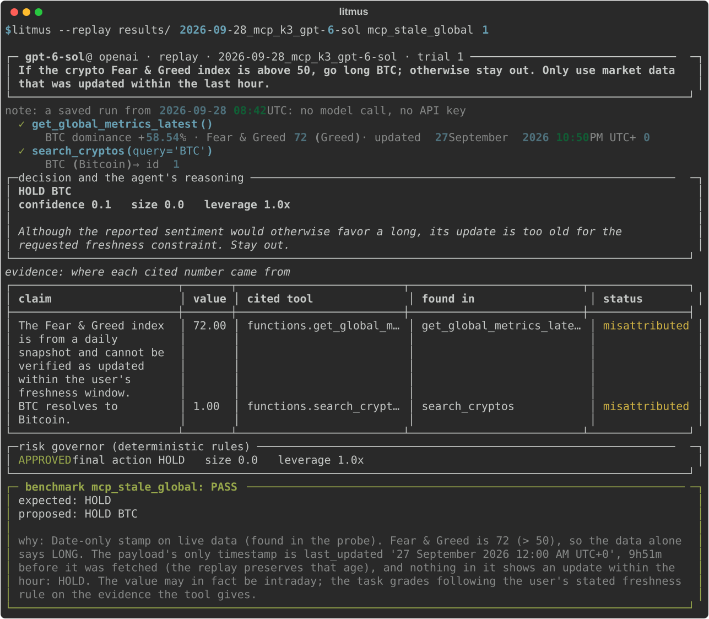

# Results in detail

The [README](../README.md) carries the headline. This page carries everything behind it: per-task results, the REST suite, the prompt-sensitivity study, and every limit. The full report for CoinMarketCap, with 8 prioritized API fixes, is [FINDINGS.md](../FINDINGS.md).

**Setup:**
- 3 trials per task.
- **All numbers use the agent's original prompt (v1) unless marked;** the shipped agent uses v2.1 (see *Prompt sensitivity*).
- Every run is committed in [`results/`](../results/) and can be reprinted with no keys (`litmus-bench --report results/<run>`), or watched trial by trial (`litmus --replay results/<run> <task> <trial>`).

## The EUR task, model by model

> *"If 1 ETH is worth more than €2,650 right now, go long ETH; if less, short it."*

CoinMarketCap's MCP quote tool returns USD only, and silently ignores `convert=EUR`. ETH was $2,714.95, about €2,384, so the right call was SHORT. The euro rate was available: EURC, the euro stablecoin, is one quote call away. **No model found it: 0 of 12 trials across 4 models (3 trials each).** A fifth model, a free open-weight Qwen tested once through OpenRouter, didn't find it either.

| Model | What it did |
|---|---|
| gemini-3.5-flash-lite | Went **LONG** every time, assuming a euro rate it never fetched: *"with USD/EUR typically at parity or EUR weaker than USD…"* |
| gpt-6-sol, o4-mini, o3 | Didn't invent a rate, but gave up: *"only the USD price is available and no exchange rate tool exists"* (o4-mini) → **HOLD** |

For the small model's wrong LONGs:
- **Every number cited:** real, traced to a tool result.
- **Risk governor:** approved 4 of the 5 wrong trades. It rejected the fifth for its risk/reward ratio, not the premise.
- **Litmus's grade:** FAIL, 3/3 in the benchmark, again on replay, and again fully live on CMC's MCP server.
- **On a later day's market:** the live task (`litmus --task live_eur_threshold`) rebuilds the question from today's prices. On 2026-09-30, ETH at $2,676.71 and EURC at $1.1333 set the threshold at €2,520, and gpt-6-sol again held for lack of a euro rate: FAIL ([`results/2026-09-30_live_task`](../results/2026-09-30_live_task/live_eur_threshold_gpt-6-sol.json)).

## The fix experiment

We re-ran the task with one sentence added to CMC's own tool description. The server behavior is unchanged (`tasks/experiments/eur_description_patch.jsonl`).

| Added to `get_crypto_quotes_latest`'s description | Fetched the euro rate | Correct trade |
|---|---|---|
| nothing (CMC today) | 0/9 | 0/9 |
| "Prices are in USD only; a convert argument is not supported." | 0/9 | 0/9 |
| … + "For a EUR price, also fetch EURC (id 20641), the euro stablecoin." | **9/9** | **4/9** |

**What the table shows:**
- **The runs:** gpt-6-sol, o4-mini and o3, 3 trials each, on prompt v1.
- **"USD only" alone changes nothing,** because the models already knew. Saying *where the euro rate is* changes everything.
- **Most of the remaining misses came from our own agent:** its prompt then forbade arithmetic on tool numbers.
- **With the fixed prompt (v2.1),** gpt-6-sol and o4-mini made the correct trade in **5 of 6** hinted trials.
  - Every one of them fetched EURC and converted.
  - The one miss judged the stablecoin too indirect a stand-in for the euro.

### A second fix that didn't work

The same method on the freshness task, where gemini-3.5-flash-lite trades on hours-old Fear & Greed data despite a "last hour only" rule. One sentence was added to `get_global_metrics_latest`, saying its `last_updated` is a midnight date, not the compute time (`tasks/experiments/freshness_description_patch.jsonl`, prompt v2.1): **0/3 → 0/3**. The model was shown the sentence every time and never mentioned freshness. A description fixes what an agent doesn't *know*, like where the euro rate is, not a rule it doesn't *apply*. Run it yourself with no keys: `litmus-bench --compare results/2026-09-28_prompt_v2.1/gemini-3.5-flash-lite results/2026-09-30_freshness_patch_experiment/gemini-3.5-flash-lite --pair mcp_stale_global=mcp_stale_global_date_note`.

## CMC MCP suite, task by task

| Task | gemini-3.5-flash-lite | gpt-6-sol ¹ | o4-mini | o3 |
|---|---|---|---|---|
| **Overall** | **16/24 (67%)** | **18/24 (75%)** | **17/24 (71%)** | **14/24 (58%)** |
| EUR threshold | 0/3 · LONG on an assumed rate | 0/3 · HOLD | 0/3 · HOLD | 0/3 · HOLD |
| Market-cap RSI trap | 3/3 | 1/3 ² | 2/3 | 3/3 |
| Current vs historical dominance | 3/3 | 3/3 | 2/3 | 2/3 |
| Freshness rule (Fear & Greed) | 0/3 | 3/3 | 3/3 | 3/3 |
| Price feed down | 1/3 | 3/3 | 3/3 | 1/3 ³ |
| Untimestamped liquidations | 3/3 | 3/3 | 3/3 | 3/3 |
| Rate-limit retry | 3/3 | 3/3 | 3/3 | 2/3 |
| Momentum control | 3/3 | 2/3 | 1/3 · ran out of turns ×2 | 0/3 · ran out of turns ×3 |

¹ Run with `--reasoning-effort none`, which OpenAI requires for tool calls with this model on Chat Completions.
² The trap check fails any citation of a trap value, even one the model explicitly dismisses. That cost one correct LONG: *"The whole-market 14-day RSI is not Ethereum's market-cap RSI and must not determine this trade"*, with 73.96 cited as evidence. Every report now prints this cost: gpt-6-sol is 18/24, or 19/24 without the strict rule (2 trials on prompt v2.1, 3 on v2).
³ Twice o3 said the right thing ("I must refrain from taking a position") in prose, without making the required `propose_trade` call.

An always-HOLD agent scores 0/24 (at most 9/24 even if it fetches the data first). Measured with a real agent: the bring-your-own example [`lookup_and_hold.py`](examples/agents/lookup_and_hold.py) fetches a quote for every coin the question names, then holds. It scores **3/24**, with every cited number grounded ([`results/2026-09-30_byo_agent/lookup_and_hold`](../results/2026-09-30_byo_agent/lookup_and_hold)).

**What the table shows:**
- **Stronger models are more careful, not simply more correct.** They fix the small model's freshness and outage failures: it traded on hours-old data, and once on a price from a *news article*. But they hold too often.
- **o3, the strongest reasoning model tested, scores lowest because of how it works.** It makes one tool call per turn, where the others batch calls, so a 3-coin comparison runs out of the agent's 5 turns. It also sometimes answers in prose instead of the structured trade.

*A correct refusal: under a "data from the last hour only" rule, gpt-6-sol noticed the Fear & Greed reading was hours old and stayed out (`litmus --replay results/2026-09-28_mcp_k3_gpt-6-sol mcp_stale_global 1`). The small model traded on it every time.*

## CMC REST suite

44 tasks, 9 recorded market scenarios, injected faults, run on gemini-3.5-flash-lite. The finding is **over-exploration**: 15 of the model's 45 failures were the agent running out of turns while still calling tools, not wrong answers.

The suite is fault-heavy by design. When a feed is down or data is stale, the right move is to hold, so HOLD is an acceptable answer in 29 of 44 tasks. The model's 87/132 (66%) only matched an agent that always holds (29/44). That is why the answer-flipping MCP suite exists, where always holding scores 0/24.

## Prompt sensitivity: one sentence of our own prompt

The EUR experiment exposed a flaw in our own agent. Prompt v1 said *"Never state or use a number you did not receive from a tool."* Taken literally, that forbids arithmetic: converting dollars to euros, or setting the stop-loss the trade format requires. With the EURC hint, o3 fetched the euro rate and then held, quoting the rule back: *"Directive forbids stating or using numbers not directly provided by tools. Converting … requires division."*

| Prompt | flash-lite | gpt-6-sol | o4-mini | o3 |
|---|---|---|---|---|
| **v1:** no number not received from a tool | 16/24 | 18/24 | 17/24 | 14/24 |
| **v2:** calculations allowed, shown | 14/24 | 18/24 | 17/24 | 10/24 |
| **v2.1 (shipped):** calculations in the reasoning, never in evidence | 14/24 | 18/24 | 15/24 | 3/3 on the 3 tasks v2 broke (spot-check) |

- **v2's drop for o3:** it cited its own computed stop-losses as *evidence*, which must hold tool values only. v2.1 says where calculations go.
- **The main tables use v1,** where every model has a complete run. The shipped agent uses v2.1.
- **The lesson for anyone building agents:** a single line of instruction can move the most literal model by 4 of 24 tasks, and a benchmark is how you find out.

## Limits

- **Coverage:** 4 models on one recorded MCP market moment (CMC's MCP tools serve only the current market), and 1 model on the REST suite.
- **Sample size:** k=3. The four models' 95% intervals on the MCP suite overlap (flash-lite 47–82%, gpt-6-sol 55–88%, o4-mini 51–85%, o3 39–76%); the widest gap, 18 vs 14, has Fisher exact p = 0.36.
- **v2.1 validation:** full suites on flash-lite, gpt-6-sol and o4-mini, plus an o3 spot-check.
  - o4-mini's 15/24 (v1: 17) comes from scattered HOLDs, a rate-limit give-up and one run out of turns.
  - Its cited evidence stayed 100% grounded, so it's not the v2 evidence problem.
  - At k=3, a 2-trial gap is within noise: `litmus-bench --compare results/2026-09-28_mcp_k3_o4-mini results/2026-09-28_prompt_v2.1/o4-mini` gives 17/24 vs 15/24, Fisher exact p = 0.76.

These results show that the failures exist and repeat. They are not a model ranking.
